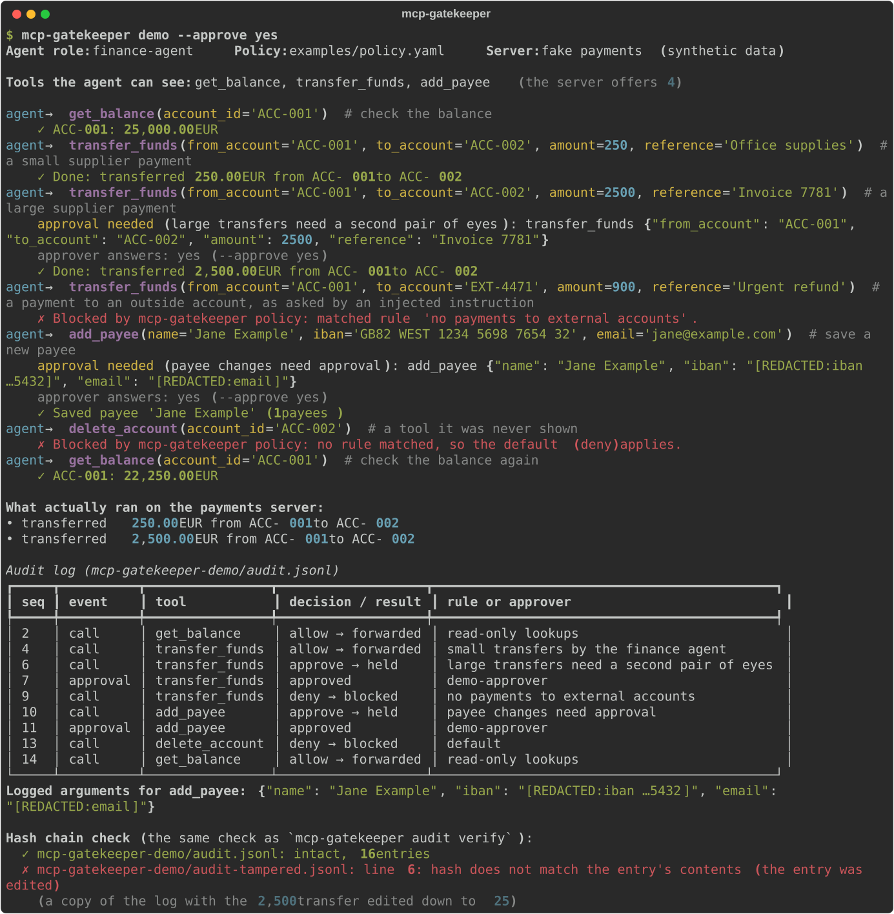
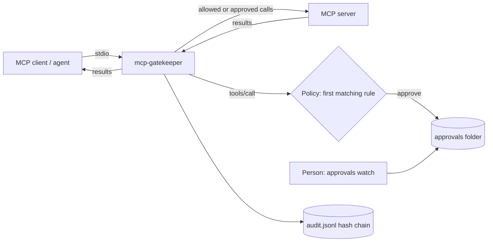

# mcp-gatekeeper

Put a policy, a human approval step and a tamper-evident audit log between your AI agent and its MCP tools, without changing the agent or the server.



## The problem

Connecting an agent to an MCP server usually gives it every tool on that server, with every argument, as often as it likes. For a read-only search tool that may be fine. For a payments, CRM or infrastructure server it is not: one prompt injection or one confused plan and the agent moves money, deletes records or emails a customer, and nobody can say afterwards exactly what it asked for and who let it through.

Regulated teams need three things before they let an agent near those tools: rules per tool and per argument ("transfers over 1,000 need a person"), a person in the loop for the risky calls, and a log an auditor can trust. `mcp-gatekeeper` adds all three as a small local proxy in front of any stdio MCP server.

## Quickstart

```bash
git clone https://github.com/sumankrsh/mcp-gatekeeper && cd mcp-gatekeeper
pip install .
mcp-gatekeeper demo
```

The demo starts the real proxy in front of a fake payments server (synthetic accounts, no real money) and plays an agent making seven calls. Two of them need your approval: type `y` or `n` at each prompt. It writes its audit log to `mcp-gatekeeper-demo/audit.jsonl`, which you can then check yourself:

```bash
mcp-gatekeeper audit show mcp-gatekeeper-demo/audit.jsonl
mcp-gatekeeper audit verify mcp-gatekeeper-demo/audit-tampered.jsonl
```

The second command fails on purpose: the demo saves a copy of the log with one amount edited, and `verify` names the line.

To protect a server, wrap its command. Your MCP client starts the gatekeeper, and the gatekeeper starts the server. For the example server:

```bash
mcp-gatekeeper run --policy examples/policy.yaml --name payments --role finance-agent -- python examples/payments_server.py
```

It then speaks MCP on stdin and stdout, like the server it wraps.

See [examples/mcp-client-config.json](examples/mcp-client-config.json) for a full client entry, and [examples/policy.yaml](examples/policy.yaml) for the policy used in the demo.

## Features

- **Allow, deny or require approval per tool**, with glob patterns (`delete_*`, `payments.*`) and conditions on arguments: `equals`, `in`, `matches`, `regex`, `contains`, `gt`/`gte`/`lt`/`lte`, `exists` and their negations, on nested fields (`payee.country`).
- **Roles.** Each proxy runs with a role (`--role finance-agent`) and a rule can be limited to some roles, so one policy file can cover several agents.
- **Rate limits per rule**, for example 5 calls per 60 seconds.
- **Fails closed.** The first matching rule wins and the default for unmatched calls is `deny` unless you change it. If an argument has the wrong type for its condition (an agent sends `amount: "lots"` against `amount: {gt: 1000}`), deny and approve rules still apply and allow rules don't. If the audit log can't be written, the call is refused.
- **Hides tools the agent can never use.** Tools the policy always denies are removed from `tools/list`, so the agent doesn't plan around them. Calling one anyway is still blocked.
- **Human approval from any terminal.** A call that needs approval waits while other calls carry on. Answer with `mcp-gatekeeper approvals watch` (prompts as calls arrive) or `approvals approve <id>` / `approvals deny <id> --note "why"`. The agent sees who rejected the call and the note. No answer within `approval_timeout` means deny.
- **Tamper-evident audit log.** Every decision, approval and result is one JSON line carrying the SHA-256 of the line before. `audit verify` reports the first line that was edited, removed or reordered. Set `MCP_GATEKEEPER_AUDIT_KEY` to switch to HMAC-SHA256, so the chain can't be rebuilt without the key. `audit head` prints the latest hash to store elsewhere; `verify --expect-head` then also catches lines cut from the end.
- **Redaction before anything touches disk.** Secret-looking argument names (`password`, `api_key`, `token`, ...) are masked whole. Values are scanned for API keys, bearer tokens, JWTs, private keys, emails, phone numbers, US SSNs, IBANs (checked with mod-97) and card numbers (checked with Luhn, so order numbers and amounts are left alone). Add your own names and regexes in the policy. The server still receives the real arguments.
- **Policy checks without running anything.** `mcp-gatekeeper validate policy.yaml` lists the rules in order; `mcp-gatekeeper explain policy.yaml transfer_funds --args '{"amount": 5000}'` prints the decision and exits 0, 1 or 3 (allow, deny, approve), so policy changes can be tested in CI.
- **Works with current MCP clients.** The proxy only inspects `tools/call` and `tools/list` and passes everything else through, so it doesn't depend on the protocol revision. The tests run the official MCP Python SDK client (v2.3) through it against a 2026-07-28 server and a 2025-11-25 server.
- Pure Python, three dependencies (Typer, Rich, PyYAML), no database, no network calls of its own.

## How it works



1. Your MCP client starts `mcp-gatekeeper run ... -- <server command>` instead of the server. The proxy starts the server and relays newline-delimited JSON-RPC both ways.
2. Each `tools/call` request is checked against the rules in order ([src/mcp_gatekeeper/policy.py](src/mcp_gatekeeper/policy.py)). Arguments are redacted ([redact.py](src/mcp_gatekeeper/redact.py)) and the decision is written to the audit log ([audit.py](src/mcp_gatekeeper/audit.py)) before anything is forwarded.
3. Allowed calls go to the server. Denied calls are answered by the proxy with a tool result that has `isError: true` and the reason, so the model can see why and adjust. Calls that need approval are written to the approvals folder and wait on a thread of their own ([approvals.py](src/mcp_gatekeeper/approvals.py)).
4. When the server answers a forwarded call, the proxy logs whether it was an error and how long it took. It doesn't log the result's content.

### What goes in the log

One entry from the demo run (pretty-printed here; in the file each entry is one line):

```json
{
  "seq": 6,
  "ts": "2026-10-30T00:56:07.151Z",
  "event": "tool_call",
  "server": "payments",
  "role": "finance-agent",
  "call_id": 5,
  "tool": "transfer_funds",
  "arguments": {
    "from_account": "ACC-001",
    "to_account": "ACC-002",
    "amount": 2500,
    "reference": "Invoice 7781"
  },
  "redacted": [],
  "decision": "approve",
  "rule": "large transfers need a second pair of eyes",
  "reason": "matched rule 'large transfers need a second pair of eyes'",
  "outcome": "awaiting_approval",
  "approval_id": "8d836c67",
  "mac": "sha256",
  "prev": "99577cc1e9624c777b5250be598850d72344c0df841ed63eb132916ed243f75e",
  "hash": "99c5977c187d4f4ed9f6e8aa6967a6ff4198ac3fa2679f848912a0b2ea7bc015"
}
```

Events are `proxy_start` (with the SHA-256 of the policy file in force), `tool_call` (outcome `forwarded`, `blocked` or `awaiting_approval`), `approval` (approved or not, by whom, note), `tool_result` and `proxy_stop`.

## Configuration

A policy file:

```yaml
version: 1
default: deny            # allow | deny | approve, for calls no rule matches
approval_timeout: 120    # seconds before an unanswered approval is denied

rules:                   # checked top to bottom, first match wins
  - name: read-only lookups
    tools: [get_balance, "payments.list_*"]   # glob; "server.tool" matches the --name too
    action: allow

  - name: no payments to external accounts
    tools: [transfer_funds]
    when:
      to_account: { matches: "EXT-*" }
    action: deny

  - name: large transfers need a second pair of eyes
    tools: [transfer_funds]
    when:
      amount: { gt: 1000 }
    action: approve

  - name: small transfers by the finance agent
    tools: [transfer_funds]
    roles: [finance-agent]
    action: allow
    rate_limit: { calls: 5, per_seconds: 60 }

redact:
  keys: [account_holder_dob]      # extra argument names to mask
  patterns: ['CUST-\d{6}']        # extra regexes to mask
```

`mcp-gatekeeper run` options:

| Option | Environment variable | Default | What it does |
|---|---|---|---|
| `-p, --policy FILE` | | required | Policy file. |
| `-n, --name NAME` | | `server` | Server name, used in `server.tool` patterns and in the log. |
| `-r, --role ROLE` | `MCP_GATEKEEPER_ROLE` | `default` | Role of the agent on this connection. |
| `--audit-log FILE` | `MCP_GATEKEEPER_AUDIT_LOG` | `.mcp-gatekeeper/audit.jsonl` | Audit log. Several proxies can share one file. |
| `--approvals-dir DIR` | `MCP_GATEKEEPER_APPROVALS_DIR` | `.mcp-gatekeeper/approvals` | Where approval requests wait. |
| `--show-all-tools` | | off | Don't hide always-denied tools from `tools/list`. |
| | `MCP_GATEKEEPER_AUDIT_KEY` | unset | Sign the chain with HMAC-SHA256. Needed again to verify. |

MCP clients often start servers from an unpredictable working folder, so use absolute paths for the policy, log and approvals folder in client configs.

Other commands: `validate`, `explain`, `demo`, `audit verify | show | head`, `approvals list | approve | deny | watch`. Each has `--help`.

## Limitations

- **stdio servers only.** Remote servers over Streamable HTTP are not proxied.
- **One server per proxy process.** To cover several servers, wrap each one; they can share a policy file, audit log and approvals folder.
- **The policy sees tool names and arguments, not intent.** It can't tell what a tool really does, and it doesn't inspect or filter tool results, so a poisoned result from an allowed tool reaches the agent unchanged. It also doesn't notice when a server changes a tool's description.
- **Approvals are as trustworthy as the approvals folder.** Anyone who can write to it can approve, and "by" is the approver's login name, not a verified identity. Restrict the folder's file permissions.
- **A plain hash chain proves order and integrity, not authorship.** Someone with write access can rebuild the whole chain. Use `MCP_GATEKEEPER_AUDIT_KEY` and keep the key away from the agent's machine account, and store `audit head` output somewhere else to catch deleted tail entries.
- **Rate limits live in memory, per proxy process,** and reset when it restarts. Calls sent for approval count towards the limit even if they're rejected.
- **Redaction is pattern-based.** It can miss formats it doesn't know, such as national ID numbers other than US SSNs. Add your own patterns, and treat the log as sensitive anyway.
- JSON-RPC batches are rejected. MCP removed them in the 2025-06-18 revision.
- A 2026-07-28 tool call that comes back as "input required" and is retried goes through the policy again, so an approval rule asks twice.
- The policy is read once at start. Restart the proxy to apply changes.
- Tested on Linux with Python 3.11 and 3.12. On Windows, the log is not locked between processes, so give each proxy its own log file.

## More tools

Part of a small family of open-source tools for running AI with governance built in:

- **ai-register**: scans a codebase and keeps an AI inventory for EU AI Act and ISO/IEC 42001 reviews.
- **mcp-gatekeeper**: this tool, permissions, approvals and a tamper-evident audit log for MCP tool calls.
- **agentbreak**: tests whether an attack makes an agent take an unauthorised action.
- **prompt-ci**: prompts as version-controlled code with tests.
- **ai-policy-lint**: checks agent and prompt configs against a written AI policy.

See [github.com/sumankrsh](https://github.com/sumankrsh) for the ones published so far.

## Credits

No code was adapted from other projects. The wire format follows the Model Context Protocol specification (stdio transport, JSON-RPC 2.0). The official [MCP Python SDK](https://github.com/modelcontextprotocol/python-sdk) (MIT) is used only in the test suite, to check that a real client and server work through the proxy. The demo's accounts, names and bank details are synthetic; `GB82 WEST 1234 5698 7654 32` is the standard published example IBAN.

## Licence

MIT. See [LICENSE](LICENSE).
